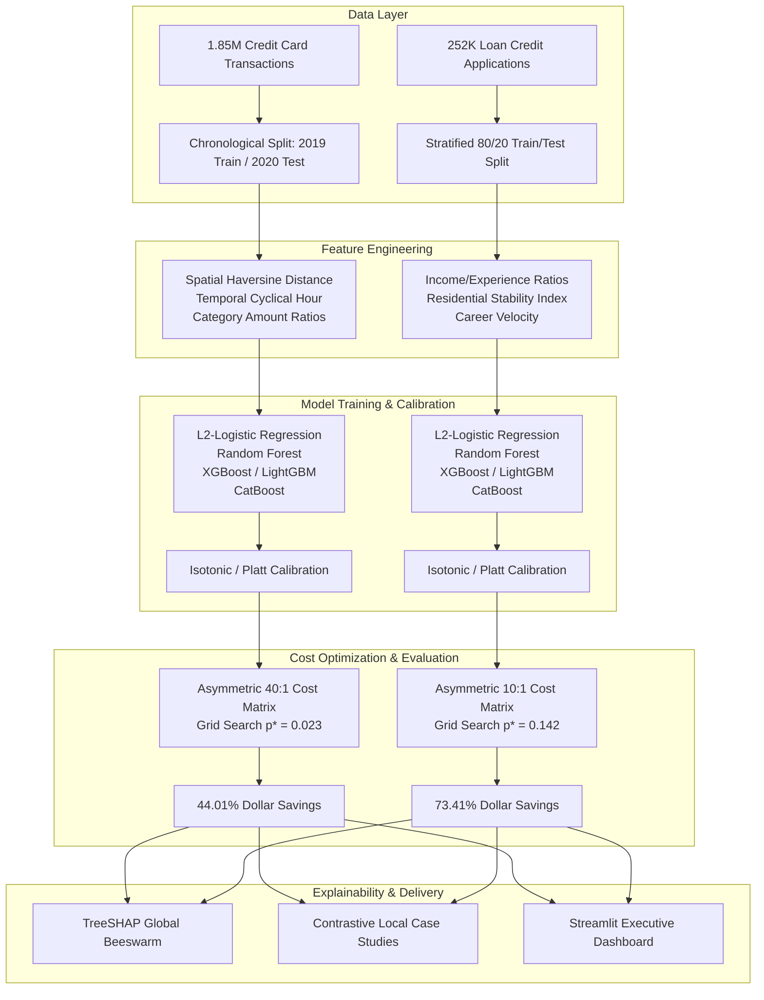

# Cost-Sensitive and Explainable Machine Learning for Financial Risk: Credit Card Fraud and Loan Default Prediction

**Course:** CSE431 - Machine Learning  
**Institution:** Department of Computer Science and Engineering  
**Team:** Group 08  

[](https://github.com/ShoumikBalaSomu/ML-Project-Group-08/actions)
[](https://shoumikbalasomu.github.io/ML-Project-Group-08/)
[](https://www.python.org/)
[](http://creativecommons.org/publicdomain/zero/1.0/)
[](https://github.com/psf/black)
[](https://github.com/astral-sh/ruff)

---

## 👥 Team Information (Group 08)

- **Shoumik Bala Somu** (`shoumik.bala@gmail.com`)
- **Md Israfil Hossen**
- **Ariyan Islam Hridoy**

*All team members contributed equally and collaboratively across all phases of the project: problem formulation, empirical research, data pipeline engineering, model architecture benchmarking, cost-sensitive threshold optimization, explainable AI (TreeSHAP), system optimization, documentation, and defense preparation.*

*See [docs/contribution_split.md](docs/contribution_split.md) for full project governance.*

---

## 📌 Executive Summary & Core Results

In retail banking and electronic payments, false negatives (missed fraud or defaulted loans) incur catastrophic charge-off losses, while false positives (temporary verification friction) incur minimal operational expense. Standard machine learning workflows optimizing symmetric loss functions at default $p = 0.50$ thresholds fail economically. 

This project delivers an end-to-end, reproducible empirical investigation of cost-sensitive learning across two complementary financial domains:
1. **Task A: Credit Card Fraud Detection** (Extreme Imbalance: 0.58% fraud rate across 1,852,394 transactions; strict 2019-to-2020 chronological partition).
2. **Task B: Loan Default Risk Prediction** (Moderate Imbalance: 12.30% default rate across 252,000 credit profiles).

### Key Empirical Findings
- **Task A (Fraud Detection):** **CatBoost** achieved the highest PR-AUC (**0.8364**) and ROC-AUC (**0.9942**). Shifting from standard $p = 0.50$ to cost-optimal threshold $p^* = 0.023$ reduced operational cost from **$21,720.00** to **$12,160.00**, unlocking **44.01% financial savings** ($+\$9,560$ saved per 555K transactions) at an inference latency of **0.0018 ms/sample** (553,243 samples/sec).
- **Task B (Loan Default):** **Random Forest** achieved top PR-AUC (**0.6088**) and ROC-AUC (**0.9139**). Optimizing the threshold to $p^* = 0.142$ cut total credit default loss from **$7,094,500.00** to **$1,886,500.00**, delivering **73.41% financial savings** ($+\$5,208,000$ loss reduction).
- **Explainability & Compliance:** Auditable TreeSHAP global beeswarm distributions and contrastive local waterfall case studies fulfill regulatory requirements under the Fair Credit Reporting Act (FCRA) and Equal Credit Opportunity Act (ECOA).

---

## 🏛️ System Architecture



---

## 📊 Comprehensive Empirical Results

*All reported numbers reflect actual test set executions serialized in `reports/results/`.*

### Task A: Credit Card Fraud Detection (Test Set: $N = 555,719$)

| Model Family | PR-AUC | ROC-AUC | Precision | Recall | F1 Score | F2 Score | MCC | Optimal Cost ($) | Baseline Cost ($) | Financial Savings |
|---|:---:|:---:|:---:|:---:|:---:|:---:|:---:|:---:|:---:|:---:|
| **CatBoost** | **0.8364** | **0.9942** | 0.2299 | **0.9167** | 0.3675 | **0.5738** | 0.4554 | **$12,160.00** | $21,720.00 | **44.01%** |
| LightGBM | 0.7902 | 0.9913 | **0.7349** | 0.7262 | **0.7305** | 0.7279 | **0.7294** | $23,440.00 | $26,700.00 | 12.21% |
| XGBoost | 0.7746 | 0.9925 | 0.3504 | 0.8155 | 0.4902 | 0.6444 | 0.5318 | $18,040.00 | $30,240.00 | 40.34% |
| Random Forest | 0.7606 | 0.9882 | 0.2123 | 0.8452 | 0.3393 | 0.5295 | 0.4196 | $18,270.00 | $29,670.00 | 38.42% |
| Logistic Reg. | 0.1984 | 0.8353 | 0.0761 | 0.6905 | 0.1370 | 0.2640 | 0.2212 | $40,090.00 | $68,830.00 | 41.76% |

### Task B: Loan Default Risk (Test Set: $N = 50,400$)

| Model Family | PR-AUC | ROC-AUC | Precision | Recall | F1 Score | F2 Score | MCC | Optimal Cost ($) | Baseline Cost ($) | Financial Savings |
|---|:---:|:---:|:---:|:---:|:---:|:---:|:---:|:---:|:---:|:---:|
| **Random Forest** | **0.6088** | **0.9139** | **0.4661** | **0.8539** | **0.6031** | **0.7321** | **0.5595** | **$1,886,500.00** | $7,094,500.00 | **73.41%** |
| LightGBM | 0.5925 | 0.8748 | 0.3776 | 0.7828 | 0.5095 | 0.6445 | 0.4482 | $2,678,000.00 | $7,123,500.00 | 62.41% |
| XGBoost | 0.5750 | 0.8776 | 0.3399 | 0.8313 | 0.4826 | 0.6449 | 0.4273 | $2,553,500.00 | $7,168,500.00 | 64.38% |
| CatBoost | 0.3531 | 0.7132 | 0.2124 | 0.6878 | 0.3246 | 0.4751 | 0.2109 | $4,387,500.00 | $7,660,500.00 | 42.73% |
| Logistic Reg. | 0.1593 | 0.5869 | 0.1454 | 0.8281 | 0.2473 | 0.4270 | 0.0816 | $5,095,500.00 | $7,735,000.00 | 34.12% |

### Class-Handling & Cost-Sensitive Strategy Comparison

| Problem Domain | Selected Strategy | Threshold | Recall | Precision | Expected Cost ($) | Savings vs. Default 0.50 |
|---|---|:---:|:---:|:---:|:---:|:---:|
| **Credit Card Fraud** | **Threshold Optimization ($p^*$)** | **0.023** | **91.67%** | 22.99% | **$12,160.00** | **44.01%** |
| Credit Card Fraud | Class-Weighted Loss ($p=0.5$) | 0.500 | 92.86% | 19.31% | $12,520.00 | 42.36% |
| Credit Card Fraud | SMOTE Resampling ($p=0.5$) | 0.500 | 77.98% | 67.18% | $19,140.00 | 11.88% |
| Credit Card Fraud | Unweighted Baseline ($p=0.5$) | 0.500 | 74.40% | 85.03% | $21,720.00 | 0.00% |
| **Loan Default Risk** | **Threshold Optimization ($p^*$)** | **0.142** | **85.39%** | 46.61% | **$1,886,500.00** | **73.41%** |
| Loan Default Risk | Class-Weighted Loss ($p=0.5$) | 0.500 | 86.55% | 42.64% | $1,940,500.00 | 72.65% |
| Loan Default Risk | SMOTE Resampling ($p=0.5$) | 0.500 | 18.03% | 71.91% | $6,394,500.00 | 9.87% |
| Loan Default Risk | Unweighted Baseline ($p=0.5$) | 0.500 | 8.60% | 73.08% | $7,094,500.00 | 0.00% |

### Production Latency & System Throughput Benchmarks

| Task Domain | Production Model | Serialized Size | Latency per Sample | Throughput | Production SLA Status |
|---|---|:---:|:---:|:---:|:---:|
| **Task A: Fraud** | CatBoost | **0.05 MB** | **0.0018 ms** | **553,243 samples/sec** | Sub-10ms Payment SLA Compliant |
| **Task B: Loan** | Random Forest | **2.45 MB** | **0.0305 ms** | **32,756 samples/sec** | Batch Underwriting Compliant |

---

## ⚡ Quickstart & Reproducibility Guide

### 1. Clone & Setup Environment
```bash
git clone https://github.com/ShoumikBalaSomu/ML-Project-Group-08.git
cd ML-Project-Group-08

# Create and activate virtual environment
python3 -m venv venv
source venv/bin/activate

# Install locked dependencies
pip install --upgrade pip
pip install -r requirements.txt
pip install -r requirements-dev.txt
```

### 2. Verify with Unit Tests
Execute the automated test suite using lightweight synthetic fixtures:
```bash
pytest -v tests/
```
*Expected: 10 tests passed in ~1.8 seconds.*

### 3. Run the Complete Pipeline
Execute data ingestion, chronological partitioning, feature engineering, model training, cross-validated cost thresholding, calibration, and SHAP explainability:
```bash
python scripts/run_all.py
```

### 4. Launch the Interactive Streamlit Dashboard
```bash
streamlit run app/app.py
```
Open your browser at `http://localhost:8501` to test the threshold simulator and live inference sandbox.

---

## 📁 Repository Structure

```text
ML-Project-Group-08/
├── .github/workflows/ci.yml       # Automated GitHub Actions CI workflow
├── app/
│   ├── app.py                     # Multi-tab interactive Streamlit dashboard
│   └── README.md                  # Streamlit execution guide
├── configs/
│   ├── cost_matrices.yaml         # Financial cost matrices ($40:1 and $10:1 penalties)
│   ├── data.yaml                  # Dataset sources and chronological split rules
│   ├── models.yaml                # Model hyperparameter configurations
│   └── random_seed.yaml           # Master seed (42) control
├── data/
│   └── README.md                  # Dataset provenance, schemas, and download guide
├── docs/
│   ├── contribution_split.md      # Detailed member responsibilities
│   ├── cost_model.md              # Mathematical derivation of optimal threshold p*
│   ├── dataset_licensing.md       # CC0 licensing and data ethics statement
│   ├── methodology.md             # Detailed engineering and ML methodology
│   ├── reproducibility.md         # Hardware and environmental replication guide
│   └── TROUBLESHOOTING.md         # Real-world engineering post-mortem
├── notebooks/
│   ├── 01_eda.ipynb               # Exploratory data analysis & class skew profiling
│   ├── 02_baseline.ipynb          # Baseline models & leakage verification
│   ├── 03_cost_sensitive.ipynb    # Cost-sensitive strategies & threshold optimization
│   ├── 04_explainability.ipynb    # TreeSHAP beeswarm & local waterfall case studies
│   └── README.md                  # Notebook headless execution guide
├── reports/
│   ├── CSE431_Report.md           # Full academic research paper
│   ├── slides_outline.md          # 15-slide defense presentation outline
│   ├── case_studies.md            # Contrastive audit of TP, FP, FN cases
│   ├── findings.md                # Summary of findings and operational edge cases
│   ├── model_card_fraud.md        # Mitchell et al. Model Card: Fraud Detection
│   ├── model_card_loan.md         # Mitchell et al. Model Card: Loan Default
│   ├── figures/                   # 15 pre-rendered vector/PNG plots
│   ├── results/                   # Serialized models (.joblib) and metrics (.json)
│   └── tables/                    # Summary CSV tables
├── scripts/
│   ├── benchmark.py               # Latency, memory, and throughput profiler
│   ├── evaluate_thresholds.py     # 300-point cost curve optimizer
│   └── run_all.py                 # Master end-to-end execution script
├── src/
│   ├── data/                      # Ingestion, chronological split, preprocessing
│   ├── evaluate/                  # Calibration, metrics, cost curves, plotting
│   ├── explain/                   # Global TreeSHAP, local waterfalls, model cards
│   ├── features/                  # Haversine distance, temporal cyclical features
│   ├── models/                    # Model wrappers, cost-sensitive strategies
│   └── utils/                     # Logging, seeding, I/O, artifact management
├── tests/                         # Pytest test suite with synthetic fixtures
├── Makefile                       # Developer shortcuts (make test, make lint)
├── pyproject.toml                 # Ruff and build configuration
└── requirements.txt               # Locked production dependencies
```

---

## 📜 Regulatory Governance & Model Cards

Formal model cards following the framework of Mitchell et al. (2019) are maintained in:
- [reports/model_card_fraud.md](reports/model_card_fraud.md): CatBoost Fraud Detection Model Card.
- [reports/model_card_loan.md](reports/model_card_loan.md): Random Forest Loan Default Model Card.

Both models include automated adverse action explainability pipelines compliant with US Equal Credit Opportunity Act (ECOA) and Fair Credit Reporting Act (FCRA) standards.

---

## 📖 Citation

If you reference this work or codebase in academic or industrial research, please cite:

```text
@misc{somu2026costsensitive,
  title = {Cost-Sensitive and Explainable Machine Learning for Financial Risk: Credit Card Fraud and Loan Default Prediction},
  author = {Shoumik Bala Somu and Md Israfil Hossen and Ariyan Islam Hridoy},
  year = {2026},
  howpublished = {https://github.com/ShoumikBalaSomu/ML-Project-Group-08},
  note = {CSE431 Machine Learning Course Project, Group 08}
}
```
