# Cost-Sensitive and Explainable Machine Learning for Financial Risk: Credit Card Fraud and Loan Default Prediction

**Course:** CSE431 - Machine Learning  
**Institution:** Department of Computer Science and Engineering  
**Team:** Group 08  

[](https://github.com/ShoumikBalaSomu/Credit-Card-Fraud-and-Loan-Default-Prediction/actions)
[](https://colab.research.google.com/github/ShoumikBalaSomu/Credit-Card-Fraud-and-Loan-Default-Prediction/blob/main/CSE431_CostSensitive_Explainable_Financial_Risk_ML.ipynb)
[](https://shoumikbalasomu.github.io/Credit-Card-Fraud-and-Loan-Default-Prediction/)
[](https://www.python.org/)
[](LICENSE)
[](https://github.com/psf/black)
[](https://github.com/astral-sh/ruff)

---

## 👥 Team Information (Group 08)

- **Shoumik Bala Somu** (`232-15-657`, `shoumik.bala@gmail.com`)
- **Md Israfil Hossen** (`232-15-455`)
- **Ariyan Islam Hridoy** (`232-15-378`)

*All team members contributed equally and collaboratively across all phases of the project: problem formulation, empirical research, data pipeline engineering, model architecture benchmarking, cost-sensitive threshold optimization, explainable AI (TreeSHAP), system optimization, documentation, and defense preparation.*

*See [docs/contribution_split.md](docs/contribution_split.md) for full project governance.*

---

## 📌 Executive Summary & Core Results

In retail banking and electronic payments, false negatives (missed fraud or defaulted accounts) incur catastrophic charge-off losses, while false positives (temporary authentication friction) incur minimal operational expense. Standard machine learning workflows optimizing symmetric loss functions at default $p = 0.50$ thresholds fail economically. 

This project delivers an end-to-end, reproducible empirical investigation of cost-sensitive learning across two financial domains encapsulated in the flagship notebook [`CSE431_CostSensitive_Explainable_Financial_Risk_ML.ipynb`](CSE431_CostSensitive_Explainable_Financial_Risk_ML.ipynb):
1. **Track A: Cost-Sensitive Credit Card Fraud Detection** (Extreme Imbalance: 0.58% fraud rate across 1,852,394 transactions; strict 2012-to-2013 chronological partition, asymmetric cost matrix: TP -$5, FP -$15, FN -(amt+$25), TN $0, Bayes dynamic threshold vs empirical cutoff $\tau^* = 0.7313$).
2. **Track B: Out-of-Time Multiclass Cardholder Risk & Default-Proxy Tiering** (Longitudinal split: Tier 0 Prime, Tier 1 Standard, Tier 2 Watchlist, Tier 3 Critical ATO).

### Key Empirical Findings
- **Track A (Fraud Detection):** **SoftVotingEnsemble** achieved the highest PR-AUC (**0.7891**) and ROC-AUC (**0.9922**), with F1 of **0.7382**, MCC of **0.7375**, and Brier score of **0.0031**. **HistGradientBoosting** achieved the maximum cost reduction, cutting total dollar loss from **$1,186,950** (Approve All baseline) to **$72,478**, unlocking **+$1,114,472 in net financial savings (93.9% cost reduction)** at an inference latency of **4.20 ms / 1,000 samples**.
- **Track B (Cardholder Risk Tiering):** **HistGradientBoosting** achieved top performance across out-of-time test cardholders ($N = 908$) with **0.2258 Macro-F1**, **0.5094 Weighted-F1**, and **0.6106 One-vs-Rest ROC-AUC**, effectively identifying elevated and critical account-takeover risk cohorts.
- **Explainability & Compliance:** Auditable TreeSHAP global beeswarm distributions, automated ECOA/FCRA/GDPR adverse action reason codes, demographic parity audit (EEOC 80% rule: 0.9986 disparate impact ratio), and zero-vulnerability offensive red-team verification.

---

## 🏛️ System Architecture

```mermaid
flowchart TD
    subgraph Layer0["Phase 0: Ingestion & Telemetry"]
        A["KaggleHub: kartik2112/fraud-detection<br/>fraudTrain.csv (1.30M) + fraudTest.csv (555K)"] --> B["SHA-256 Checksum & Memory Downcasting<br/>float32, int32, category (Peak RAM < 1.8 GB)"]
    end

    subgraph Layer1["Phase 1 & 2: Privacy Preprocessing & Feature Pipelines"]
        B --> C["PCI-DSS & GDPR Compliance Sanitization<br/>Drop PAN cc_num, names, street, dob, trans_num"]
        C --> D["Zero-Leakage Chronological Partition (unix_time)<br/>Train (80%), Validation (20%), Untouched Test (555K)"]
        D --> E["Domain Feature Engineering Pipeline<br/>Haversine Distance, Cyclical Time (sin/cos),<br/>Amount Ratio vs Median, Causal 24h Velocity"]
    end

    subgraph Layer2["Phase 3: Track A — Cost-Sensitive Binary Fraud Detection"]
        E --> F["Asymmetric Business Cost Loss Matrix<br/>C_TP = -$5, C_FP = -$15, C_FN = -(amt + $25), C_TN = $0"]
        F --> G["Model Zoo Benchmark<br/>LogisticRegression, RandomForest, HistGradientBoosting, LightGBM, Soft-Voting"]
        G --> H["Validation Threshold Sweep & Bayes Dynamic Cutoff<br/>p*(amt) = 15 / (amt + 35) • Dollar Loss Minimization"]
        H --> I["Out-of-Time Test Set Evaluation (N = 555,719)<br/>PR-AUC: 0.7891, ROC-AUC: 0.9922<br/>93.9% Loss Reduction (+$1,114,472 Net Savings)"]
    end

    subgraph Layer3["Phase 4: Track B — Out-of-Time Multiclass Cardholder Risk Tiering"]
        E --> J["Longitudinal Cohort Construction<br/>Obs Window W_obs (70%) -> Perf Window W_perf (30%)"]
        J --> K["4-Class Ground-Truth Tiers (N = 908 Holdout Cardholders)<br/>Tier 0: Prime • Tier 1: Standard<br/>Tier 2: Watchlist • Tier 3: Critical ATO"]
        K --> L["Multiclass Benchmark & Portfolio Risk Matrix<br/>HistGradientBoosting: Weighted-F1 0.5094, OvR ROC-AUC 0.6106"]
    end

    subgraph Layer4["Phase 5 & 6: Explainability, Fairness & Red-Teaming"]
        I --> M["Global TreeSHAP & Permutation Importance<br/>Partial Dependence Plots (PDP) on Top Risk Drivers"]
        L --> M
        M --> N["ECOA / FCRA Adverse Action Notice Generator<br/>4 Contrastive Waterfall Case Studies (TP, FP, FN, TN)"]
        N --> O["Fairness Audit (EEOC 80% Rule Passed)<br/>Disparate Impact Ratio = 0.9986"]
        O --> P["Offensive Red-Team Adversarial Robustness Battery<br/>Zero PII Leakage, Micro-Splits, Coordinate Jitter Invariant"]
    end

    subgraph Layer5["Phase 7: Production Inference & Interactive Delivery"]
        P --> Q["Interactive Live Risk & Explainability Simulator<br/>Embedded HTML/JS HUD with Real-Time Reactive Cutoffs<br/>Production Throughput: 238,000 tx/sec (<0.005 ms/sample)"]
    end
```



---

## 📊 Comprehensive Empirical Results

*All reported numbers reflect actual executed out-of-time test holdouts from `CSE431_CostSensitive_Explainable_Financial_Risk_ML.ipynb`.*

### Track A: Binary Fraud Detection Benchmark (Test Set: $N = 555,719$, Baseline Loss = $1,186,950)

| Model Family | PR-AUC | ROC-AUC | F1 ($\tau^*$) | F2 ($\tau^*$) | MCC | Brier Score | Loss @ 0.50 | Loss @ $\tau^*$ | Net Savings ($) | Cost Red. (%) | Latency (ms/1k) |
|---|:---:|:---:|:---:|:---:|:---:|:---:|:---:|:---:|:---:|:---:|:---:|
| **SoftVotingEnsemble** | **0.7891** | **0.9922** | **0.7382** | **0.7245** | **0.7375** | **0.0031** | **$90,852** | $147,933 | +$1,039,017 | 87.5% | 14.11 ms |
| CalibratedLightGBM | 0.7813 | 0.9925 | 0.6995 | 0.7093 | 0.6985 | 0.0033 | $96,567 | $165,869 | +$1,021,081 | 86.0% | 8.19 ms |
| LightGBM | 0.7653 | 0.9950 | 0.5707 | 0.7110 | 0.6024 | 0.0068 | $97,833 | $78,111 | +$1,108,839 | 93.4% | 6.16 ms |
| **HistGradientBoosting** | 0.7634 | 0.9945 | 0.5743 | 0.7081 | 0.6032 | 0.0069 | $97,824 | **$72,478** | **+$1,114,472** | **93.9%** | 4.20 ms |
| RandomForest | 0.7474 | 0.9910 | 0.6407 | 0.7128 | 0.6484 | 0.0085 | $120,051 | $122,234 | +$1,064,716 | 89.7% | 2.69 ms |
| LogisticRegression | 0.2152 | 0.9424 | 0.2400 | 0.4012 | 0.3182 | 0.0709 | $683,768 | $198,467 | +$988,482 | 83.3% | 0.07 ms |
| Dummy (Approve All) | 0.5019 | 0.5000 | 0.0000 | 0.0000 | 0.0000 | 0.0050 | $1,186,950 | $1,186,950 | +$0 | 0.0% | 0.06 ms |

### Track B: Multiclass Cardholder Risk Tiering Benchmark (Test Set: $N = 908$ Cardholders)

| Model Family | Macro-F1 | Weighted-F1 | Cohen's Kappa | Quadratic Weighted Kappa | One-vs-Rest ROC-AUC |
|---|:---:|:---:|:---:|:---:|:---:|
| **HistGradientBoosting** | **0.2258** | **0.5094** | **0.0356** | 0.0268 | **0.6106** |
| MLP Classifier | 0.2054 | 0.5010 | 0.0347 | 0.0477 | 0.6043 |
| Random Forest (Balanced) | 0.2017 | 0.4139 | 0.0289 | 0.0017 | 0.6096 |
| Multinomial Logistic Regression | 0.1481 | 0.1923 | 0.0266 | **0.0522** | 0.5779 |

### Production Latency & System Throughput Benchmarks

| Task Domain | Production Model | Serialized Size | Latency per Sample | Throughput | Production SLA Status |
|---|---|:---:|:---:|:---:|:---:|
| **Track A: Fraud** | HistGradientBoosting | **1.2 MB** | **0.0042 ms** | **238,095 samples/sec** | Sub-10ms Payment SLA Compliant (<5ms) |
| **Track A: Fraud** | CalibratedLightGBM | **0.9 MB** | **0.0082 ms** | **122,100 samples/sec** | Sub-10ms Payment SLA Compliant (<10ms) |
| **Track B: Risk Tiering** | HistGradientBoosting | **0.8 MB** | **0.0051 ms** | **196,078 samples/sec** | Batch Underwriting Compliant |

---

## ⚡ Quickstart & Reproducibility Guide

### 🌟 Primary Deliverable: Industry-Grade Single Master Notebook
The entire machine learning lifecycle (data ingestion, memory governance, EDA, privacy-first feature pipelines, Track A cost-sensitive binary fraud detection, Track B out-of-time multiclass risk tiering, TreeSHAP explainability, adverse action notice generation, algorithmic fairness, red-team assertions, and the live interactive HTML simulator) is encapsulated inside **ONE standalone Jupyter Notebook**:
- **[`CSE431_CostSensitive_Explainable_Financial_Risk_ML.ipynb`](CSE431_CostSensitive_Explainable_Financial_Risk_ML.ipynb)**

Evaluators can open this single file locally, on Google Colab Free Tier, or on Kaggle Notebooks Free Tier, click **Run All**, and reproduce 100% of results cleanly at $0 infrastructure cost.

### 📥 Dataset Source & Exact Kagglehub Loader
The primary ground-truth credit card transaction dataset is sourced directly from Kaggle (`kartik2112/fraud-detection`):
```python
import kagglehub

path = kagglehub.dataset_download("kartik2112/fraud-detection")
print("Path to dataset files:", path)
```
- `fraudTrain.csv` (1,296,675 transactions, Jan 2019 – Jun 2020)
- `fraudTest.csv` (555,719 transactions, Jun 2020 – Dec 2020, strict out-of-time test set)

### 🚀 1-Click Interactive Google Colab Demo
Execute the complete end-to-end pipeline with zero local installation directly in your browser:

[](https://colab.research.google.com/github/ShoumikBalaSomu/Credit-Card-Fraud-and-Loan-Default-Prediction/blob/main/CSE431_CostSensitive_Explainable_Financial_Risk_ML.ipynb)

Both [`CSE431_CostSensitive_Explainable_Financial_Risk_ML.ipynb`](CSE431_CostSensitive_Explainable_Financial_Risk_ML.ipynb) and [`FinRisk_ML_Group08.ipynb`](FinRisk_ML_Group08.ipynb) are fully pre-rendered and verified.

### 1. Clone & Setup Environment
```bash
git clone https://github.com/ShoumikBalaSomu/Credit-Card-Fraud-and-Loan-Default-Prediction.git
cd Credit-Card-Fraud-and-Loan-Default-Prediction

# Create and activate virtual environment
python3 -m venv venv
source venv/bin/activate

# Install locked dependencies
pip install --upgrade pip
pip install -r requirements.txt
pip install -r requirements-dev.txt
```

### 2. Verify with Automated Test Suite
Execute the comprehensive Pytest verification battery:
```bash
python3 -m pytest tests/ -v
```
*Expected: 20 passed across cost optimization, scikit-learn pipelines, notebook integrity, and security audits.*

### 3. Run the Master Notebook
Execute interactively or headless:
```bash
jupyter notebook CSE431_CostSensitive_Explainable_Financial_Risk_ML.ipynb
```
Or execute headless via nbconvert:
```bash
python3 -m nbconvert --to notebook --execute --inplace CSE431_CostSensitive_Explainable_Financial_Risk_ML.ipynb
```

### 4. Interactive Financial Cost Simulator
Open the client-side interactive simulator directly in your browser or launch the local documentation server:
```bash
make pages
```
Navigate to `http://localhost:8000/simulator.html` to explore the interactive threshold simulator and adverse action explainability sandbox.

---

## 📁 Repository Structure

```text
Credit-Card-Fraud-and-Loan-Default-Prediction/
├── .github/workflows/ci.yml       # Automated GitHub Actions CI workflow (Black, Ruff, Pytest)
├── CSE431_CostSensitive_Explainable_Financial_Risk_ML.ipynb # 🌟 Primary Master Notebook: Standalone dual-track ML system
├── FinRisk_ML_Group08.ipynb       # Mirrored Master Notebook: Complete end-to-end ML pipeline with Colab button
├── configs/
│   ├── cost_matrices.yaml         # Financial cost matrices ($40:1 and $10:1 penalties)
│   ├── data.yaml                  # Dataset sources and chronological split rules
│   ├── models.yaml                # Model hyperparameter configurations
│   └── random_seed.yaml           # Master seed (42) control
├── data/
│   └── README.md                  # Dataset provenance, schemas, and download guide
├── docs/                          # Interactive GitHub Pages showcase & documentation
│   ├── index.html                 # Academic project showcase homepage
│   ├── about.html                 # Authors, mission, and repository guide
│   ├── methodology.html           # Full methodology, mathematical derivations & KaTeX
│   ├── benchmarks.html            # Empirical results, metric tables & ROC/PR curves
│   ├── explainability.html        # Global TreeSHAP and local waterfall case studies
│   ├── simulator.html             # Client-side interactive financial cost simulator
│   ├── contribution_split.md      # Detailed member responsibilities
│   ├── cost_model.md              # Mathematical derivation of optimal threshold p*
│   ├── dataset_licensing.md       # CC0 licensing and data ethics statement
│   ├── methodology.md             # Detailed engineering and ML methodology
│   ├── reproducibility.md         # Hardware and environmental replication guide
│   └── TROUBLESHOOTING.md         # Real-world engineering post-mortem
├── notebooks/
│   ├── FinRisk_ML_Group08.ipynb   # Mirrored copy of unified master notebook
│   └── README.md                  # Notebook execution guide and Google Colab launch instructions
├── reports/
│   ├── CSE431_Report.md           # Full academic research paper
│   ├── slides_outline.md          # 15-slide defense presentation outline
│   ├── case_studies.md            # Contrastive audit of TP, FP, FN cases
│   ├── findings.md                # Summary of findings and operational edge cases
│   ├── model_card_fraud.md        # Mitchell et al. Model Card: Fraud Detection
│   ├── model_card_loan.md         # Mitchell et al. Model Card: Loan Default
│   ├── figures/                   # 15 pre-rendered vector/PNG plots
│   ├── results/                   # Serialized models (.joblib) and metrics (.json)
│   └── tables/                    # Summary CSV tables
├── tests/                         # Fast Pytest test suite (all pass in ~1.3s)
│   ├── test_notebook_integrity.py # Validates schema, Colab badge, authors, no Bengali
│   ├── test_data_cleaning_and_sklearn.py # Validates imputation, winsorization, sklearn pipelines
│   └── test_cost_optimization.py  # Validates cost matrix math and threshold optimizer
├── Makefile                       # Developer shortcuts (make test, make lint, make notebook)
├── pyproject.toml                 # Ruff, Black, and Pytest configuration
└── requirements.txt               # Locked production dependencies
```

---

## 📜 Regulatory Governance & Model Cards

Formal model cards following the framework of Mitchell et al. (2019) are maintained in:
- [reports/model_card_fraud.md](reports/model_card_fraud.md): CatBoost Fraud Detection Model Card.
- [reports/model_card_loan.md](reports/model_card_loan.md): Random Forest Loan Default Model Card.

Both models include automated adverse action explainability pipelines compliant with US Equal Credit Opportunity Act (ECOA) and Fair Credit Reporting Act (FCRA) standards.

---

## 🌐 Multi-Remote Git Deployment

This repository is mirrored and continuously deployed across four global version control platforms for high availability, institutional archiving, and public auditability:

| Platform | Remote Name | Repository URL | Purpose |
|:---|:---:|:---|:---|
| **GitHub** | `origin` | `https://github.com/ShoumikBalaSomu/Credit-Card-Fraud-and-Loan-Default-Prediction.git` | Primary active repo, CI/CD, GitHub Pages |
| **GitLab** | `gitlab` | `https://gitlab.com/ShoumikBalaSomu/credit-card-fraud-and-loan-default-prediction.git` | Mirror, secondary CI/CD pipeline |
| **Bitbucket** | `bitbucket` | `https://bitbucket.org/shoumikbalasomu/credit-card-fraud-and-loan-default-prediction.git` | Enterprise Atlassian ecosystem mirror |
| **SourceForge** | `sourceforge` | `https://git.code.sf.net/p/finrisk-ml-group08/code` | Open-source archival mirror |

---

## 🎓 Viva Voce Defense Guide (Top 5 Examiner Questions)

| # | Examiner Question | Recommended Technical Defense Response |
|:---:|:---|:---|
| **Q1** | *Why optimize threshold for dollar loss instead of standard F1 score?* | Standard metrics (F1, Accuracy) treat all errors symmetrically with equal cost ($1.0$). In credit risk, a missed $\$5,000$ fraud is $500\times$ more damaging than a missed $\$10$ charge. Minimizing total dollar loss directly aligns the mathematical loss function with the institutional fiduciary objective. |
| **Q2** | *How do you guarantee zero temporal leakage across train, val, and test splits?* | We sort strictly by `unix_time` and enforce monotonic non-overlapping chronological cutoffs: $\max(\text{Train}) < \min(\text{Val}) \le \max(\text{Val}) < \min(\text{Test})$. All preprocessing estimators (TargetEncoders, Scalers) are fitted strictly on the training partition. |
| **Q3** | *How does Track B formulate cardholder risk without synthetic labels?* | We partition cardholder transaction history longitudinally into an observation window ($W_{obs}$, first 70% of time) and a performance window ($W_{perf}$, final 30% of time). Feature aggregates are computed solely in $W_{obs}$, while true risk tiers (0 to 3) are derived strictly from subsequent events in $W_{perf}$, guaranteeing zero future lookahead. |
| **Q4** | *How do you satisfy regulatory explainability under ECOA Regulation B & FCRA?* | We extract exact TreeSHAP values from tree ensembles to identify the top 3 negative risk drivers per transaction and translate them into legally defensible adverse action reason codes that explain the decision without exposing proprietary model weights. |
| **Q5** | *What is the advantage of instance-dependent Bayes thresholding $\tau_i^*(\text{amt}_i)$?* | A fixed threshold either over-flags low-dollar purchases (high friction) or under-protects against high-dollar fraud. The dynamic Bayes threshold $\tau_i^*(\text{amt}) = \frac{C_{\text{friction}}}{\text{amt} + C_{\text{chargeback}} + C_{\text{friction}} - C_{\text{review}}}$ automatically scales the required probability of fraud inversely with the transaction dollar amount. |

---

## 📖 Citation

If you reference this work or codebase in academic or industrial research, please cite:

```text
@misc{somu2026costsensitive,
  title = {Cost-Sensitive and Explainable Machine Learning for Financial Risk: Credit Card Fraud and Loan Default Prediction},
  author = {Shoumik Bala Somu and Md Israfil Hossen and Ariyan Islam Hridoy},
  year = {2026},
  howpublished = {https://github.com/ShoumikBalaSomu/Credit-Card-Fraud-and-Loan-Default-Prediction},
  note = {CSE431 Machine Learning Course Project, Group 08}
}
```
