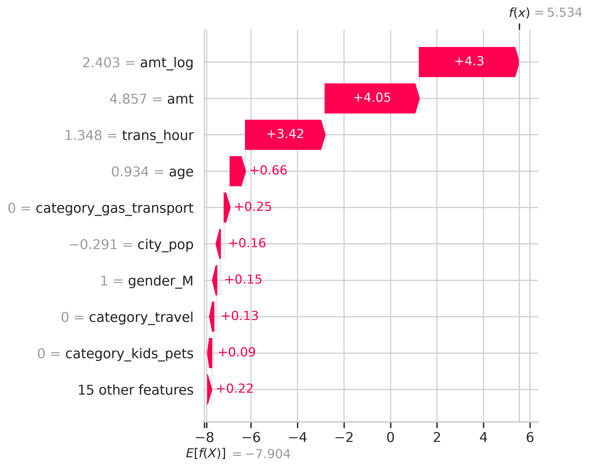
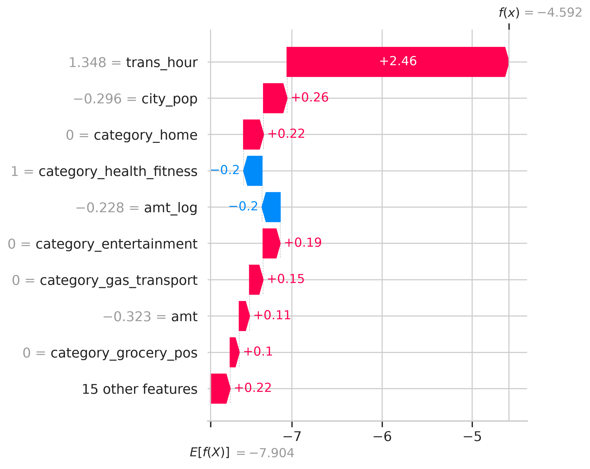
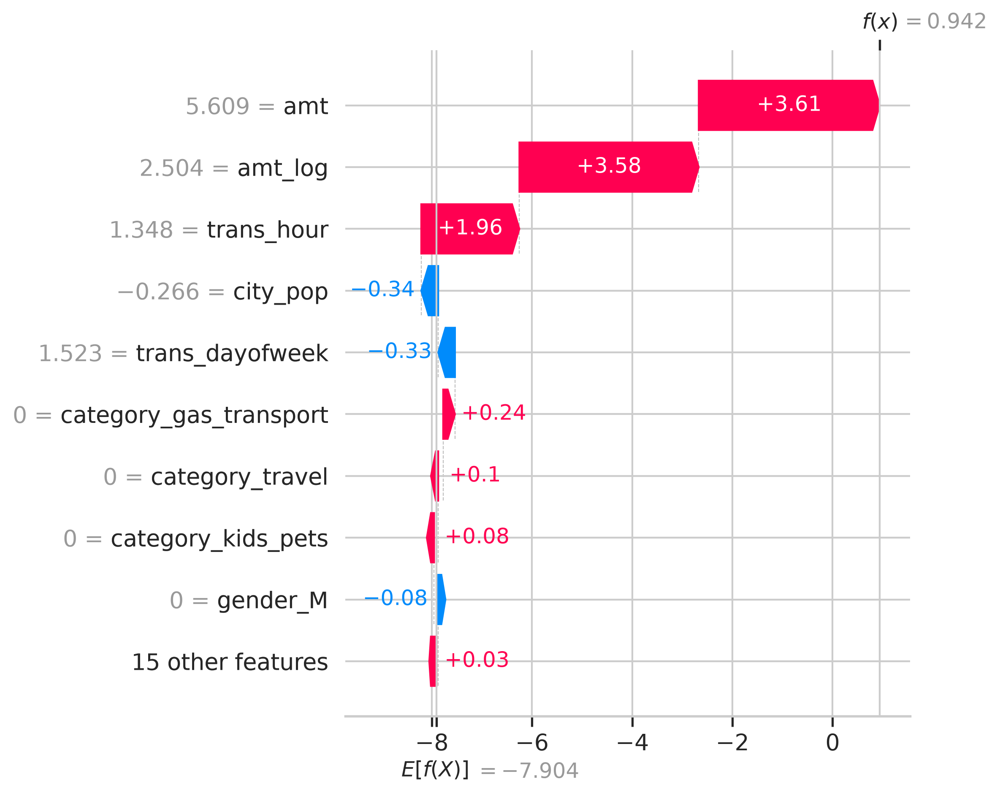
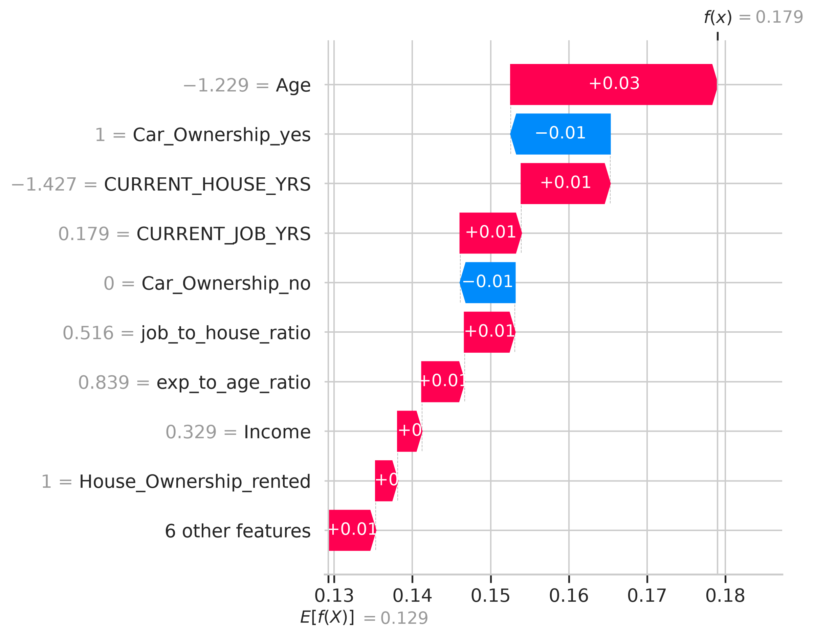
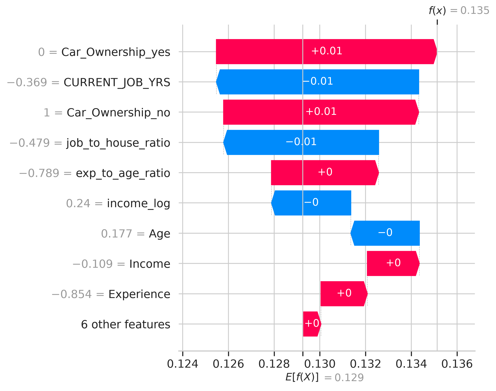

# Local Explainability Case Studies

This report documents 5 individual high-impact predictions using local SHAP attributions and human-readable contrastive justifications.

### Case: 1. Correctly Caught Fraud (True Positive)
- **Domain Task:** `FRAUD` Risk Classification
- **Model Predicted Probability:** `0.9935` (Decision Threshold: `0.12`)
- **Decision:** `FLAGGED / POSITIVE`
- **Instance Attributes:**
  - `category`: misc_net
  - `amt`: $780.52
  - `city_pop`: 1306
  - `age`: 62
  - `dist_to_merch_km`: 66.09791725557658

### Case: 2. Missed Fraud (False Negative)
- **Domain Task:** `FRAUD` Risk Classification
- **Model Predicted Probability:** `0.0089` (Decision Threshold: `0.12`)
- **Decision:** `CLEARED / NEGATIVE`
- **Instance Attributes:**
  - `category`: health_fitness
  - `amt`: $24.84
  - `city_pop`: 23
  - `age`: 51
  - `dist_to_merch_km`: 80.64913963942968

### Case: 3. False Alarm / Legitimate Blocked (False Positive)
- **Domain Task:** `FRAUD` Risk Classification
- **Model Predicted Probability:** `0.4930` (Decision Threshold: `0.12`)
- **Decision:** `FLAGGED / POSITIVE`
- **Instance Attributes:**
  - `category`: misc_net
  - `amt`: $890.22
  - `city_pop`: 8874
  - `age`: 20
  - `dist_to_merch_km`: 121.2354148508759

### Case: 4. Correctly Predicted Default (True Positive)
- **Domain Task:** `LOAN` Risk Classification
- **Model Predicted Probability:** `0.1502` (Decision Threshold: `0.13`)
- **Decision:** `FLAGGED / POSITIVE`
- **Instance Attributes:**
  - `Income`: $5,953,603.00
  - `Age`: 29
  - `Experience`: 11
  - `House_Ownership`: rented
  - `Car_Ownership`: yes

### Case: 5. Approved-but-Defaulted Borrower (False Negative)
- **Domain Task:** `LOAN` Risk Classification
- **Model Predicted Probability:** `0.1334` (Decision Threshold: `0.13`)
- **Decision:** `CLEARED / NEGATIVE`
- **Instance Attributes:**
  - `Income`: $4,697,227.00
  - `Age`: 53
  - `Experience`: 5
  - `House_Ownership`: rented
  - `Car_Ownership`: no

